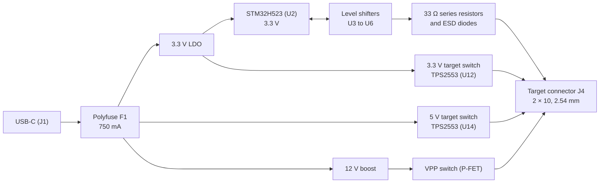

# OpenMUPP v1 probe board

OpenMUPP v1 is a multi-protocol programming and debug probe.
The design is open hardware.
The board name is `OpenMUPP v1`.
The KiCad 10 project is in this repository.

**Disclaimer:** this project is in no way related to or associated with the original Versaloon project or its author. This board is an independent hardware design.

## What the board does

- It runs **USB CDC, CMSIS-DAP v2 and EDBG (AVR) at the same time** in one firmware image.
- It transfers data **faster than the original Versaloon Mini**. The core runs at 250 MHz.
- It connects to targets from **1.2 V to 5 V** through level shifters. A 1.2 V target is limited to about 5 MHz.
- It supplies the target with **3.3 V (up to about 520 mA) or 5 V (up to about 300 mA)**.
- It makes **12 V (VPP)** for high-voltage programming of AVR and PIC parts.
- It has **one target connector (J4)**. A passive adapter board maps J4 to each target pinout.

## Hardware overview

| Block | Part | Notes |
|-------|------|-------|
| MCU | STM32H523CC, LQFP48 (U2) | Cortex-M33, 250 MHz, 256 KB flash, 272 KB RAM. 24 MHz crystal (Y1). |
| USB | USB-C receptacle (J1), USBLC6-2SC6 (U1) | USB 2.0 full speed. 5.1 kΩ CC resistors. |
| 3.3 V rail | XC6220B331MR-G LDO | Supplies the MCU and the target power switch. |
| VBUS protection | 750 mA polyfuse (F1) | Expect `+5V` near 4.4 V at full load. |
| Target power | TPS2553 (U12, 3.3 V), TPS2553 (U14, 5 V) | Current limit about 520 mA (ILIM 51 kΩ) at 3.3 V and about 300 mA (ILIM 91 kΩ) at 5 V. Both outputs join `VTREF`. See [Target power](#target-power). |
| VPP | MT3608 boost (U13), AO3401A P-FET (Q2), BSS138 drivers (Q3, Q5) | See [High voltage (VPP)](#high-voltage-vpp). |
| Level shifters | SN74LXC8T245 (U3, U4), SN74LXC1T45 (U5, U6) | All parts work from 1.1 V to 5.5 V. |
| Reset path | BSS138 (Q1), U4 channel 4 | Q1 pulls nRESET low. U4 reads the line back. |
| ESD | TPD4E05U06 (U8 to U10) | On all J4 signals except the supplies. |
| Probe debug | J3 (5-pin SWD) | Debugs the probe MCU only. **It is not a target connector.** |
| User I/O | SW1 (key and BOOT0), LEDs D1 and D4 (state) and D2 (USB) | |

### Sheets

| File | Content |
|------|---------|
| `openmupp-v1.kicad_sch` | Root sheet: MCU (U2), USB-C (J1) and its ESD part (U1), VBUS fuse (F1), crystal (Y1), probe debug header (J3), LEDs, key. |
| `target_interface.kicad_sch` | Level shifters, ESD, series resistors, target connector J4, `ADAPTER_ID` clamp, `VTREF` sense divider. |
| `power.kicad_sch` | 3.3 V LDO, 12 V boost, VPP switch, target power switches (U12, U14). |
| `openmupp-v1.kicad_sym` | Project symbols (TPS2553). |

The power sheet has five inputs from the MCU: `VPP_EN` (PC14), `VPP_ON` (PC15), `VPP_12V_SEL` (PA8), `TARGET_PWR_EN` (PB8) and `TARGET_5V_EN` (PB10). It has one output, `VPP_SENSE` (PA4). It makes the global nets `VPP` and `VTREF`.

### Level shifting

The probe MCU always runs at 3.3 V. The target side of each shifter runs from `VTREF`, the target voltage.

| Target signal | Direction | Shifter |
|---------------|-----------|---------|
| TCK, TDI, TRST, `AUX1`, `AUX2` | Out | U3, direction pin `DIR_OUT` |
| TDO, RTCK, UART RX, nRESET read-back | In | U4, fixed target to probe |
| TMS / SWDIO | Both | U5, direction pin `DIR_SWDIO` |
| UART TX | Out | U6, fixed |
| nRESET / debugWIRE, drive | Out, open-drain | BSS138 (Q1), low side |

- **Idle state.** `DIR_OUT` and `DIR_SWDIO` have external 100 kΩ pull-downs (R26, R27). A floating direction pin selects target to probe, so the target side is high-impedance. This also holds while the MCU is in reset.
- **nRESET path.** Q1 has its source on GND and its drain on nRESET. The MCU never drives nRESET high. A 100 kΩ pull-down (R28) keeps the gate low while the MCU is in reset. U4 channel 4 reads the real line level back. The USART sees its own transmit, so it can detect collisions.
- **Spare channels.** U4 channels 5 to 8 are unused. Their B inputs are tied to GND. The A outputs are not connected. `DIR` and `~OE` are tied to GND, so U4 always works from target to probe.
- **Pull-ups.** 2.2 kΩ to `VTREF` on SWDIO (R22). The one-wire interface needs the fast rise time. 10 kΩ to `VTREF` on TDO, RTCK, UART RX and nRESET. The shifters have dynamic 100 kΩ pull-downs, so an external pull-up must be 15 kΩ or less.
- **UART TX has its own shifter.** U6 is a fixed-direction part, so it always drives the line. U3 shares one direction pin (`DIR_OUT`). While `DIR_OUT` is low, the target side of U3 is high-impedance, and `T_UART_TX` has no pull-up. The UART bridge must work when the JTAG outputs are released, so UART TX does not use the free channels of U3.
- **Series resistors.** 33 Ω (R11 to R21) on all J4 signals except pin 16 (`ADAPTER_ID`). The shifter edges are fast.
- **VTref sense.** A 100 kΩ / 100 kΩ divider (R5, R6) and a 100 nF capacitor (C4) go to PB0.
- **Isolation.** A shifter isolates the target when `VTREF` is below 100 mV.
- **Round-trip delay.** The two translators add about 26 ns at 3.3 V and 34 ns at 1.8 V (maximum values). The firmware uses a sample delay at high clock rates.

### Target connector J4

J4 is a 2 × 10 IDC header, 2.54 mm. The footprint in the schematic is `Connector_IDC:IDC-Header_2x10_P2.54mm_Horizontal`. Use a shrouded and keyed header. VPP is on pin 19, so a shifted plug must not fit.

| Pin | Signal | Pin | Signal |
|-----|--------|-----|--------|
| 1 | `VTREF`: target voltage sense, and target supply when the probe powers the target | 2 | Reserved (no connect) |
| 3 | GND | 4 | TMS / SWDIO / data (`DIR_SWDIO`) |
| 5 | GND | 6 | TCK / SWCLK / SCK |
| 7 | GND | 8 | TDO / SWO / MISO |
| 9 | GND | 10 | TDI / MOSI |
| 11 | RTCK | 12 | nRESET / debugWIRE, open-drain |
| 13 | UART TX (probe output) | 14 | UART RX (probe input) |
| 15 | TRST | 16 | Adapter ID (ADC, 3.3 V domain) |
| 17 | `AUX1` | 18 | `AUX2` |
| 19 | VPP (8.4 V or 12 V, gated) | 20 | GND |

- **Target power is on pin 1.** One pin carries the sense and the supply. The limit is about 520 mA at 3.3 V and about 300 mA at 5 V.
- **Pin 2 is reserved.** A later adapter that needs a second supply pin can use it, with its own switch.
- **Pin 16 goes to the adapter only.** It never goes to the target.

### Target power

Two TPS2553 switches output to `VTREF`. U12 switches the 3.3 V rail. U14 switches `+5V`.

- `TARGET_PWR_EN` (PB8) high: U12 supplies 3.3 V to the target. The limit is about 520 mA.
- `TARGET_5V_EN` (PB10) high: U14 supplies 5 V to the target. The limit is about 300 mA. R42 (10 kΩ) is in series with the enable pin of U14.
- Both low: `VTREF` senses the target voltage. The parts block reverse current.

Q4 (BSS138) pulls the enable pin of U14 low when `TARGET_PWR_EN` is high. Thus 3.3 V has priority if the firmware sets both pins by mistake.

The interlock does not remove the overlap in a change from 5 V to 3.3 V. The firmware must use this sequence for each change:

1. If both switches are off, measure `VTREF_SENSE`. If the target has its own supply, do not turn on a switch.
2. Turn off both switches.
3. Wait at least 10 ms.
4. For a change from 5 V to 3.3 V, wait until `VTREF` is less than 3.4 V. `VTREF_SENSE` shows half of `VTREF`, so wait for less than 1.7 V.
5. Turn on one switch.

Expect about 4.4 V on `VTREF` at 5 V and full board load, because of the polyfuse F1 and the drop in U14.

### High voltage (VPP)

The MT3608 boost makes the VPP voltage. The boost passes its input through when it is off. Thus a P-FET switch gates VPP.

The default VPP voltage is 8.4 V. This level is safe for PIC parts with VIHH = 8 V to 9 V. VIHH is the high voltage that the part needs on its MCLR pin to start programming. R34 (130 kΩ, design value; the schematic has 191 kΩ, see issue #6) and R35 (10 kΩ) set it. To get 12 V, the firmware sets `VPP_12V_SEL` (PA8) high. This turns on Q5, which puts R45 (21.5 kΩ) in parallel with R35. R46 (100 kΩ) pulls the gate low, so a reset or a floating pin gives 8.4 V.

The boost cannot pull its output down. Thus the firmware must change the level in this order:

1. Set `VPP_ON` low.
2. Set `VPP_12V_SEL` to the new level.
3. Keep `VPP_EN` high. Wait until C29 discharges to the new level (0.5 s to 1 s when it goes from 12 V down to 8.4 V). If this takes more than 2 s, stop and report an error.
4. Set `VPP_ON` high.

`VPP_SENSE` measures the boost output through a divider (R47 100 kΩ, R48 33 kΩ). At 8.4 V, the ADC pin gets about 2.1 V. At 12 V, it gets about 3.0 V. The firmware reads it before it sets `VPP_ON`, and after a level change to see that C29 has discharged.

The firmware must set **both** `VPP_EN` (PC14) and `VPP_ON` (PC15) high to apply VPP on J4 pin 19. Both pins have pull-downs. The firmware applies VPP only when the adapter ID shows a high-voltage adapter and the protocol needs VPP.

A high-voltage adapter is not passive. It must protect the shared line from VPP, for example with a diode and a resistor on UPDI. All other adapters are passive.

### Adapter boards and adapter ID

An adapter board has connectors, wires and one ID resistor. The resistor goes from J4 pin 16 to GND. R30 (10 kΩ) pulls pin 16 up to 3.3 V. The firmware reads the ratio x = RID / (RID + 10 kΩ) on PB1. The ADC reference and R30 share the 3.3 V rail, so supply drift cancels. R44 (10 kΩ) in series and the diode D5 (BAT54C) to 3.3 V protect PB1 (net `ADAPTER_ID_MCU`). They work when a 5 V target supply is on pin 16 by mistake. The firmware must use a long ADC sample time and keep the internal pull resistors off.

The AVR 10-pin connector uses the Atmel-ICE pinout. Three passive variants route the data pin to SWDIO:

| Variant | Protocols | Slot |
|---------|-----------|------|
| A | JTAG, ISP, debugWIRE | 1 |
| B | PDI | 2 |
| C | TPI, UPDI, aWire | 3 |

| Slot | RID (E24, 1 %) | x | Accept window | Use |
|------|------------------|-------|---------------|-----|
| — | 0 Ω (short) | 0.000 | below 0.05 | Fault: pin 16 shorted to GND |
| 1 | 1.1 kΩ | 0.099 | 0.05 to 0.15 | Variant A |
| 2 | 2.4 kΩ | 0.194 | 0.15 to 0.25 | Variant B |
| 3 | 4.3 kΩ | 0.301 | 0.25 to 0.35 | Variant C |
| 4 | 6.8 kΩ | 0.405 | 0.35 to 0.45 | Free |
| 5 | 10 kΩ | 0.500 | 0.45 to 0.55 | Free |
| 6 | 15 kΩ | 0.600 | 0.55 to 0.65 | Free |
| 7 | 24 kΩ | 0.706 | 0.65 to 0.75 | Free |
| 8 | 39 kΩ | 0.796 | 0.75 to 0.85 | Free |
| 9 | 91 kΩ | 0.901 | 0.85 to 0.95 | Free (suggested: high-voltage adapter) |
| — | open | 1.000 | above 0.95 | No adapter |

The worst-case error is about 0.007 in x, and the windows are ±0.05 wide. The firmware treats a free slot as "unknown adapter" and does not enable VPP.

### MCU pin map

| Function | Pin | Notes |
|----------|-----|-------|
| TCK / SWCLK / ISP SCK | PB13 | SPI2_SCK, master |
| TDI / ISP MOSI | PB15 | SPI2_MOSI |
| TDO / ISP MISO | PB14 | SPI2_MISO. Same net as PA3 (USART2_RX, for SWO). |
| TMS / SWDIO | PA6, PA7 | One net on the A side of U12 |
| `DIR_SWDIO` | PB5 | GPIO (TIM3_CH2, AF2, for the one-wire engine), with external pull-down |
| `DIR_OUT` | PB12 | GPIO, with external pull-down |
| TRST, RTCK | PB4, PA0 | GPIO |
| nRESET / debugWIRE drive (`SRST`) | PB6 | LPUART1_TX, inverted, to the gate of Q1 |
| nRESET / debugWIRE read-back (`SRST_RX`) | PB7 | LPUART1_RX, from U4 |
| UART TX, UART RX | PA9, PA10 | USART1 |
| `AUX1`, `AUX2` | PA2, PB3 | Outputs in the `DIR_OUT` group |
| USB | PA11, PA12 | USB D− and D+ |
| `VTREF_SENSE`, `ADAPTER_ID` | PB0, PB1 | ADC |
| `TARGET_PWR_EN` | PB8 | 3.3 V target switch (U12) |
| `TARGET_5V_EN` | PB10 | 5 V target switch (U14), through R42 |
| `VPP_EN`, `VPP_ON` | PC14, PC15 | |
| `VPP_12V_SEL` | PA8 | Low: 8.4 V. High: 12 V. |
| `VPP_SENSE` | PA4 | ADC. Divider R47, R48 and C32 on the boost output (before Q2). |
| LED state 1, LED state 2, LED USB | PB2, PA1, PA15 | |
| Key and BOOT0 | PC13 | Also the jump to the ROM USB bootloader |
| Probe debug | PA13, PA14 | SWDIO, SWCLK on J3 |

PB9 is unused. Most H5 pins are in analog mode at reset, which is the reason for the external pull resistors on the direction pins.

## Firmware

The firmware is the `openmupp` project. Firmware updates use the ROM USB DFU bootloader of the STM32H5. Press the key (or use `VERSALOON_FW_UPDATE`) to jump to it. Then use `dfu-util` or STM32CubeProgrammer.

Related repositories:

- Firmware: <https://github.com/OpenMUPP/openmupp>
- Drivers: <https://github.com/armint/system-stm32> and <https://github.com/armint/libart-stm32>

## Getting started

### Requirements

- KiCad 10.0.6 or newer.
- The shared footprint libraries. They are not public. The PCB file has a copy of each footprint, so you can open and edit the board without them. The project uses the nicknames `resistors`, `capacitors`, `headers`, `connectors`, `inductors` and `sot`. The stock KiCad libraries (`Package_*`, `Connector_IDC`, `Diode_SMD`, `LED_SMD`, `Fuse`, `Button_Switch_SMD`) must also be present.

### Open the project

1. Clone this repository.
2. Clone `kicad-footprints`.
3. In KiCad, open **Preferences, Manage Footprint Libraries**. Add each `*.pretty` directory of `kicad-footprints` with its name as the nickname, without `.pretty`.
4. Open `openmupp-v1.kicad_pro`.

The project symbol library `openmupp-v1` is in the repository. `sym-lib-table` links it with `${KIPRJMOD}`.

### Conventions

- **Reference designators are unique across all sheets.** Check before you add a part.
- **Every part has an `LCSC` field** for JLCPCB assembly. Prefer parts from the JLCPCB basic library. Each extended part costs a setup fee.
- **Small N-FETs:** use the BSS138 (LCSC C112239).
- **Footprints:** add new footprints to `kicad-footprints`, not to this project. Check the pads against the datasheet land pattern.
- **Checks:** run ERC after each change. Look for shorted nets and for unconnected pins.

### Fabrication

The layout is not done. When it is ready, order from JLCPCB with assembly. The BOM uses the `LCSC` field.

## Open items

- **VPP level: R34 is wrong in the schematic.** The design needs R34 = 130 kΩ (8.4 V default, 12 V with `VPP_12V_SEL`). The schematic has 191 kΩ, which gives about 12 V by default and about 17 V with `VPP_12V_SEL` high. Do not order the board before R34 is 130 kΩ (issue #6).
- **TCK link (PB13 to PA5).** R10 (0 Ω) is fitted between PA5 and the `TCK` net. The SPI fast path can then shift TMS with SPI1 in slave mode. PA5 is not 5 V tolerant, so it must stay on the MCU side.
- **ERC.** The ERC has one error: the outputs of U12 and U14 are both power outputs on `VTREF`. This is on purpose (Q4 is the interlock). It also shows 15 pin-type warnings and many off-grid endpoint and library warnings.
- **J4 footprint.** The schematic uses the horizontal 2 × 10 IDC header. Check the shroud, the key and the orientation against the datasheet before layout.
- **Not yet measured.** The delay of the translators at 1.8 V, 3.3 V and 5 V, and the SPI slave output delay of the H5 at fast-path clocks.

## License

Copyright Armin van der Togt 2026.

This design is licensed under the CERN Open Hardware Licence Version 2 - Strongly Reciprocal (CERN-OHL-S-2.0). See [LICENSE](LICENSE).
The design has no warranty. Refer to the licence for the applicable conditions.
