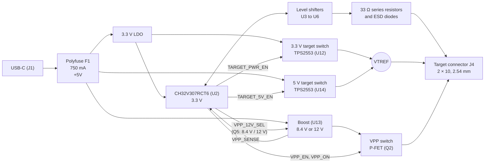

# OpenMUPP v1 probe board

OpenMUPP v1 is a multi-protocol programming and debug probe.
The design is open hardware.
The board name is `OpenMUPP v1`.
The KiCad 10 project is in this repository.

## What the board does

- It runs **USB CDC, CMSIS-DAP v2 and EDBG (AVR) at the same time** in one firmware image.
- It transfers data **faster than the original Versaloon Mini**. The core runs at 144 MHz, and USB runs at high speed (480 Mbit/s).
- It connects to targets from **1.2 V to 5 V** through level shifters. A 1.2 V target is limited to about 5 MHz.
- It supplies the target with **3.3 V (up to about 520 mA) or 5 V (up to about 300 mA)**.
- It makes a selectable **VPP of 8.4 V or 12 V** for high-voltage programming of AVR and PIC parts.
- It has **one target connector (J4)**. A passive adapter board maps J4 to each target pinout.

## Hardware overview

| Block | Part | Notes |
|-------|------|-------|
| MCU | CH32V307RCT6, LQFP64 (U2) | QingKe V4F RISC-V, 144 MHz, 256 KB flash, 64 KB SRAM. 8 MHz crystal (Y1). |
| USB | USB-C receptacle (J1), USBLC6-2SC6 (U1) | USB 2.0 high speed (USBHS on PB6, PB7). 5.1 kΩ CC resistors. |
| 3.3 V rail | XC6220B331MR-G LDO | Supplies the MCU and the target power switch. |
| VBUS protection | 750 mA polyfuse (F1) | Expect `+5V` near 4.4 V at full load. |
| Target power (3.3 V or 5 V) | TPS2553 (U12, 3.3 V), TPS2553 (U14, 5 V), BSS138 interlock (Q4) | Current limit about 520 mA (ILIM 51 kΩ) at 3.3 V and about 300 mA (ILIM 91 kΩ) at 5 V. Both outputs join `VTREF`. See [Target power](docs/hardware.md#target-power). |
| VPP (8.4 V or 12 V) | MT3608 boost (U13), AO3401A P-FET (Q2), BSS138 drivers (Q3, Q5) | The firmware selects the level with `VPP_12V_SEL`. See [High voltage (VPP)](docs/hardware.md#high-voltage-vpp). |
| Level shifters | SN74LXC8T245 (U3, U4), SN74LXC1T45 (U5, U6) | All parts work from 1.1 V to 5.5 V. |
| Reset path | BSS138 (Q1), U4 channel 4 | Q1 pulls nRESET low. U4 reads the line back. |
| ESD | TPD4E05U06 (U8 to U10) | On all J4 signals except the supplies. |
| Probe debug | J3 (5-pin SWD) | Debugs the probe MCU only. **It is not a target connector.** |
| User I/O | SW1 (key and BOOT0), LEDs D1 and D4 (state) and D2 (USB) | |

### Target connector J4

J4 is a 2 × 10 IDC header, 2.54 mm. The footprint in the schematic is `Connector_IDC:IDC-Header_2x10_P2.54mm_Horizontal`. Use a shrouded and keyed header. VPP is on pin 19, so a shifted plug must not fit.

| Pin | Signal | Pin | Signal |
|-----|--------|-----|--------|
| 1 | `VTREF`: target voltage sense, and target supply when the probe powers the target | 2 | Reserved (no connect) |
| 3 | GND | 4 | TMS / SWDIO / data (`DIR_SWDIO`) |
| 5 | GND | 6 | TCK / SWCLK / SCK |
| 7 | GND | 8 | TDO / SWO / MISO |
| 9 | GND | 10 | TDI / MOSI |
| 11 | RTCK | 12 | nRESET / debugWIRE, open-drain |
| 13 | UART TX (probe output) | 14 | UART RX (probe input) |
| 15 | TRST | 16 | Adapter ID (ADC, 3.3 V domain) |
| 17 | `AUX1` | 18 | `AUX2` |
| 19 | VPP (8.4 V or 12 V, gated) | 20 | GND |

- **Target power is on pin 1.** One pin carries the sense and the supply. The limit is about 520 mA at 3.3 V and about 300 mA at 5 V.
- **Pin 2 is reserved.** A later adapter that needs a second supply pin can use it, with its own switch.
- **Pin 16 goes to the adapter only.** It never goes to the target.

### Adapter boards and adapter ID

An adapter board has connectors, wires and one ID resistor. The resistor goes from J4 pin 16 to GND. R30 (10 kΩ) pulls pin 16 up to 3.3 V. The firmware reads the ratio x = RID / (RID + 10 kΩ) on PB1. The ADC reference and R30 share the 3.3 V rail, so supply drift cancels. R44 (10 kΩ) in series and one diode of D5 (BAT54C) to 3.3 V protect PB1 (net `ADAPTER_ID_MCU`). They work when a 5 V target supply is on pin 16 by mistake. Only one anode of D5 is on `ADAPTER_ID_MCU`. The other anode is on GND, so its leakage does not go into PB1. The firmware must use a long ADC sample time and keep the internal pull resistors off.

The AVR 10-pin connector uses the Atmel-ICE pinout. Three passive variants route the data pin to SWDIO:

| Variant | Protocols | Slot |
|---------|-----------|------|
| A | JTAG, ISP, debugWIRE | 1 |
| B | PDI | 2 |
| C | TPI, UPDI, aWire | 3 |

| Slot | RID (E24, 1 %) | x | Accept window | Use |
|------|------------------|-------|---------------|-----|
| — | 0 Ω (short) | 0.000 | below 0.05 | Fault: pin 16 shorted to GND |
| 1 | 1.1 kΩ | 0.099 | 0.05 to 0.15 | Variant A |
| 2 | 2.4 kΩ | 0.194 | 0.15 to 0.25 | Variant B |
| 3 | 4.3 kΩ | 0.301 | 0.25 to 0.35 | Variant C |
| 4 | 6.8 kΩ | 0.405 | 0.35 to 0.45 | Free |
| 5 | 10 kΩ | 0.500 | 0.45 to 0.55 | Free |
| 6 | 15 kΩ | 0.600 | 0.55 to 0.65 | Free |
| 7 | 24 kΩ | 0.706 | 0.65 to 0.75 | Free |
| 8 | 39 kΩ | 0.796 | 0.75 to 0.85 | Free |
| 9 | 91 kΩ | 0.901 | 0.85 to 0.95 | Free (suggested: high-voltage adapter) |
| — | open | 1.000 | above 0.95 | No adapter |

The worst-case error is about 0.007 in x, and the windows are ±0.05 wide. The firmware treats a free slot as "unknown adapter" and does not enable VPP.

See [docs/hardware.md](docs/hardware.md) for the sheets, level shifting, target power, VPP and the MCU pin map.

## Firmware

The firmware is the `openmupp` project. The CH32V307 has a ROM bootloader. It can program the flash through USART1 or USB (WCH ISP protocol). Hold SW1 (BOOT0) during reset to start it. The firmware port to the CH32V307 is in progress. A firmware jump to the bootloader is not available yet.

Related repositories:

- Firmware: <https://github.com/OpenMUPP/openmupp>
- Drivers: <https://github.com/armint/ch32v00x-system> and <https://github.com/armint/ch32v00x-art>

## Getting started

### Requirements

- KiCad 10.0.6 or newer.
- The shared footprint libraries. They are not public. The PCB file has a copy of each footprint, so you can open and edit the board without them. The project uses the nicknames `resistors`, `capacitors`, `headers`, `connectors`, `inductors` and `sot`. The stock KiCad libraries (`Package_*`, `Connector_IDC`, `Diode_SMD`, `LED_SMD`, `Fuse`, `Button_Switch_SMD`) must also be present.

### Open the project

1. Clone this repository.
2. Open `openmupp-v1.kicad_pro`.

The board and the schematic open without the shared footprint libraries. To change a footprint, edit the copy in the PCB file.

The project symbol library `openmupp-v1` is in the repository. `sym-lib-table` links it with `${KIPRJMOD}`.

### Conventions

- **Reference designators are unique across all sheets.** Check before you add a part.
- **Every part has an `LCSC` field** for JLCPCB assembly. Prefer parts from the JLCPCB basic library. Each extended part costs a setup fee.
- **Small N-FETs:** use the BSS138 (LCSC C112239).
- **Footprints:** check the pads against the datasheet land pattern.
- **Checks:** run ERC after each change. Look for shorted nets and for unconnected pins.

## License

Copyright Armin van der Togt 2026.

This design is licensed under the CERN Open Hardware Licence Version 2 - Strongly Reciprocal (CERN-OHL-S-2.0). See [LICENSE](LICENSE).
The design has no warranty. Refer to the licence for the applicable conditions.
