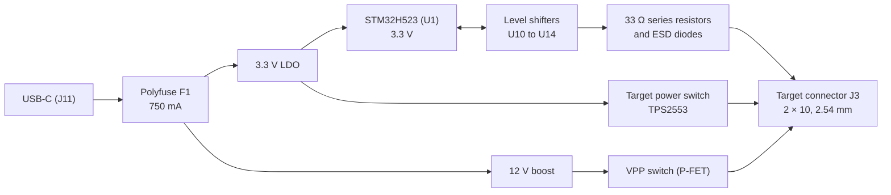

# OpenMUPP v1 probe board

OpenMUPP v1 is a multi-protocol programming and debug probe.
The design is open hardware.
The board name is `OpenMUPP v1`.
The KiCad 10 project is in this repository.

**Disclaimer:** this project is in no way related to or associated with the original Versaloon project or its author. This board is an independent hardware design.

## What the board does

- It runs **USB CDC, CMSIS-DAP v2 and EDBG (AVR) at the same time** in one firmware image.
- It transfers data **faster than the original Versaloon Mini**. The core runs at 250 MHz.
- It connects to targets from **1.2 V to 5 V** through level shifters. A 1.2 V target is limited to about 5 MHz.
- It supplies the target with up to about 520 mA.
- It makes **12 V (VPP)** for high-voltage programming of AVR and PIC parts.
- It has **one target connector (J3)**. A passive adapter board maps J3 to each target pinout.

## Hardware overview

| Block | Part | Notes |
|-------|------|-------|
| MCU | STM32H523CC, LQFP48 (U1) | Cortex-M33, 250 MHz, 256 KB flash, 272 KB RAM. 24 MHz crystal (Y1). |
| USB | USB-C receptacle (J11), USBLC6-2SC6 (U5) | USB 2.0 full speed. 5.1 kΩ CC resistors. |
| 3.3 V rail | XC6220B331MR-G LDO | Supplies the MCU and the target power switch. |
| VBUS protection | 750 mA polyfuse (F1) | Expect `+5V` near 4.4 V at full load. |
| Target power | TPS2553 (U7) | Current limit about 520 mA (ILIM 51 kΩ). The output is `VTREF`. |
| VPP | MT3608 boost (U6), AO3401A P-FET (Q3) | See [High voltage (VPP)](#high-voltage-vpp). |
| Level shifters | SN74LXC8T245 (U10), SN74LXC2T45 (U11), SN74LXC1T45 (U12 to U14) | All parts work from 1.1 V to 5.5 V. |
| Reset path | BSS138 (Q1) | Open-drain nRESET and debugWIRE. |
| ESD | TPD4E05U06 (U15 to U17) | On all J3 signals except the supplies. |
| Probe debug | J2 (STDC14), J4 (5-pin SWD) | Debug the probe MCU only. **They are not target connectors.** |
| User I/O | SW1 (key and BOOT0), LEDs D8 (state) and D9 (USB) | |

### Sheets

| File | Content |
|------|---------|
| `openmupp-v1.kicad_sch` | Root sheet: U1, USB-C, VBUS fuse, crystal, J2, J4, LEDs, key. |
| `target_interface.kicad_sch` | Level shifters, ESD, series resistors, target connector J3. |
| `power.kicad_sch` | 3.3 V LDO, 12 V boost, VPP switch, target power switch. |
| `openmupp-v1.kicad_sym` | Project symbols (TPS2553). |

The power sheet has three inputs from the MCU: `VPP_EN` (PC14), `VPP_ON` (PC15) and `TARGET_PWR_EN` (PB8). It makes the global nets `VPP` and `VTREF`.

### Level shifting

The probe MCU always runs at 3.3 V. The target side of each shifter runs from `VTREF`, the target voltage.

| Target signal | Direction | Shifter |
|---------------|-----------|---------|
| TCK, TDI, TRST, `AUX1`, `AUX2` | Out | U10, direction pin `DIR_OUT` |
| TDO, RTCK | In | U11, fixed target to probe |
| TMS / SWDIO | Both | U12, direction pin `DIR_SWDIO` |
| UART TX | Out | U13, fixed |
| UART RX | In | U14, fixed |
| nRESET / debugWIRE | Open-drain, both | BSS138 (Q1) |

- **Idle state.** `DIR_OUT` and `DIR_SWDIO` have external 100 kΩ pull-downs (R26, R27). A floating direction pin selects target to probe, so the target side is high-impedance. This also holds while the MCU is in reset.
- **Pull-ups.** 2.2 kΩ to `VTREF` on SWDIO (R22). The one-wire interface needs the fast rise time. 10 kΩ to `VTREF` on TDO, RTCK, UART RX and nRESET. The shifters have dynamic 100 kΩ pull-downs, so an external pull-up must be 15 kΩ or less.
- **Series resistors.** 33 Ω (R31 to R41) on all J3 signals. The shifter edges are fast.
- **VTref sense.** A 100 kΩ / 100 kΩ divider (R42, R43) and a 100 nF capacitor go to PB0.
- **Isolation.** A shifter isolates the target when `VTREF` is below 100 mV.
- **Round-trip delay.** The two translators add about 26 ns at 3.3 V and 34 ns at 1.8 V (maximum values). The firmware uses a sample delay at high clock rates.

### Target connector J3

J3 is a 2 × 10 IDC header, 2.54 mm. The footprint is `Connector_IDC:IDC-Header_2x10_P2.54mm_Vertical`. Use a shrouded and keyed header. VPP is on pin 19, so a shifted plug must not fit.

| Pin | Signal | Pin | Signal |
|-----|--------|-----|--------|
| 1 | `VTREF`: target voltage sense, and target supply when the probe powers the target | 2 | Reserved (no connect) |
| 3 | GND | 4 | TMS / SWDIO / data (`DIR_SWDIO`) |
| 5 | GND | 6 | TCK / SWCLK / SCK |
| 7 | GND | 8 | TDO / SWO / MISO |
| 9 | GND | 10 | TDI / MOSI |
| 11 | RTCK | 12 | nRESET / debugWIRE, open-drain |
| 13 | UART TX (probe output) | 14 | UART RX (probe input) |
| 15 | TRST | 16 | Adapter ID (ADC, 3.3 V domain) |
| 17 | `AUX1` | 18 | `AUX2` |
| 19 | VPP (12 V, gated) | 20 | GND |

- **Target power is on pin 1.** One pin carries the sense and the supply. The limit is about 520 mA.
- **Pin 2 is reserved.** A later adapter that needs a second supply pin can use it, with its own switch.
- **Pin 16 goes to the adapter only.** It never goes to the target.

### Target power

The TPS2553 sits on the 3.3 V rail. Its output is `VTREF`.

- `TARGET_PWR_EN` high: the probe supplies the target.
- `TARGET_PWR_EN` low: `VTREF` senses the target voltage. The part blocks reverse current.

### High voltage (VPP)

The MT3608 boost makes 12 V. The boost passes its input through when it is off. Thus a P-FET switch gates VPP.

The firmware must set **both** `VPP_EN` (PC14) and `VPP_ON` (PC15) high to apply VPP on J3 pin 19. Both pins have pull-downs. The firmware applies VPP only when the adapter ID shows a high-voltage adapter and the protocol needs VPP.

A high-voltage adapter is not passive. It must protect the shared line from VPP, for example with a diode and a resistor on UPDI. All other adapters are passive.

### Adapter boards and adapter ID

An adapter board has connectors, wires and one ID resistor. The resistor goes from J3 pin 16 to GND. R30 (10 kΩ) pulls pin 16 up to 3.3 V. The firmware reads the ratio x = RID / (RID + 10 kΩ) on PB1. The ADC reference and R30 share the 3.3 V rail, so supply drift cancels.

The AVR 10-pin connector uses the Atmel-ICE pinout. Three passive variants route the data pin to SWDIO:

| Variant | Protocols | Slot |
|---------|-----------|------|
| A | JTAG, ISP, debugWIRE | 1 |
| B | PDI | 2 |
| C | TPI, UPDI, aWire | 3 |

| Slot | RID (E24, 1 %) | x | Accept window | Use |
|------|------------------|-------|---------------|-----|
| — | 0 Ω (short) | 0.000 | below 0.05 | Fault: pin 16 shorted to GND |
| 1 | 1.1 kΩ | 0.099 | 0.05 to 0.15 | Variant A |
| 2 | 2.4 kΩ | 0.194 | 0.15 to 0.25 | Variant B |
| 3 | 4.3 kΩ | 0.301 | 0.25 to 0.35 | Variant C |
| 4 | 6.8 kΩ | 0.405 | 0.35 to 0.45 | Free |
| 5 | 10 kΩ | 0.500 | 0.45 to 0.55 | Free |
| 6 | 15 kΩ | 0.600 | 0.55 to 0.65 | Free |
| 7 | 24 kΩ | 0.706 | 0.65 to 0.75 | Free |
| 8 | 39 kΩ | 0.796 | 0.75 to 0.85 | Free |
| 9 | 91 kΩ | 0.901 | 0.85 to 0.95 | Free (suggested: high-voltage adapter) |
| — | open | 1.000 | above 0.95 | No adapter |

The worst-case error is about 0.007 in x, and the windows are ±0.05 wide. The firmware treats a free slot as "unknown adapter" and does not enable VPP.

### MCU pin map

| Function | Pin | Notes |
|----------|-----|-------|
| TCK / SWCLK / ISP SCK | PB13 | SPI2_SCK, master |
| TDI / ISP MOSI | PB15 | SPI2_MOSI |
| TDO / ISP MISO | PB14 | SPI2_MISO. Same net as PA3 (USART2_RX, for SWO). |
| TMS / SWDIO | PA6, PA7 | One net on the A side of U12 |
| `DIR_SWDIO` | PB5 | GPIO (TIM3_CH2, AF2, for the one-wire engine), with external pull-down |
| `DIR_OUT` | PB12 | GPIO, with external pull-down |
| TRST, RTCK | PB4, PA0 | GPIO |
| nRESET / debugWIRE | PB10 | USART3_TX, half-duplex, through the open-drain path |
| UART TX, UART RX | PA9, PA10 | USART1 |
| `AUX1`, `AUX2` | PA2, PA4 | Outputs in the `DIR_OUT` group |
| USB | PA11, PA12 | USB D− and D+ |
| `VTREF_SENSE`, `ADAPTER_ID` | PB0, PB1 | ADC |
| `TARGET_PWR_EN` | PB8 | |
| `VPP_EN`, `VPP_ON` | PC14, PC15 | |
| LED state 1, LED state 2, LED USB | PB2, PA1, PA15 | |
| Key and BOOT0 | PC13 | Also the jump to the ROM USB bootloader |
| Probe debug | PA13, PA14, PB6, PB7 | SWDIO, SWCLK, `DBG_TX`, `DBG_RX` on J2 |

PA8, PB3 and PB9 are unused. Most H5 pins are in analog mode at reset, which is the reason for the external pull resistors on the direction pins.

## Firmware

The firmware is the `openmupp` project. Firmware updates use the ROM USB DFU bootloader of the STM32H5. Press the key (or use `VERSALOON_FW_UPDATE`) to jump to it. Then use `dfu-util` or STM32CubeProgrammer.

Related repositories:

- Firmware: <https://gitlab.vandertogt.org/embedded-projects/openmupp>
- Drivers: <https://gitlab.vandertogt.org/embedded-libraries/system-stm32> and <https://gitlab.vandertogt.org/embedded-libraries/libart-stm32>
- KiCad footprints: <https://private footprint library>

## Getting started

### Requirements

- KiCad 10.0.6 or newer.
- The shared footprint libraries from the `kicad-footprints` repository (see above). The project uses the nicknames `resistors`, `capacitors`, `headers`, `connectors`, `inductors` and `sot`. The stock KiCad libraries (`Package_*`, `Connector_IDC`, `Diode_SMD`, `LED_SMD`, `Fuse`, `Button_Switch_SMD`) must also be present.

### Open the project

1. Clone this repository.
2. Clone `kicad-footprints`.
3. In KiCad, open **Preferences, Manage Footprint Libraries**. Add each `*.pretty` directory of `kicad-footprints` with its name as the nickname, without `.pretty`.
4. Open `openmupp-v1.kicad_pro`.

The project symbol library `openmupp-v1` is in the repository. `sym-lib-table` links it with `${KIPRJMOD}`.

### Conventions

- **Reference designators are unique across all sheets.** Check before you add a part. R22 to R41 and C20 to C29 are on the target sheet.
- **Every part has an `LCSC` field** for JLCPCB assembly. Prefer parts from the JLCPCB basic library. Each extended part costs a setup fee.
- **Small N-FETs:** use the BSS138 (LCSC C112239).
- **Footprints:** add new footprints to `kicad-footprints`, not to this project. Check the pads against the datasheet land pattern.
- **Checks:** run ERC after each change. Look for shorted nets and for unconnected pins.

### Fabrication

The layout is not done. When it is ready, order from JLCPCB with assembly. The BOM uses the `LCSC` field.

## Open items

- **TCK link (PB13 to PA5).** The schematic has a 0 Ω resistor (R55, not fitted) between PA5 and the `TCK` net. Fit it only if the SPI fast path must shift TMS. PA5 is not 5 V tolerant, so it must stay on the MCU side.
- **Full ERC.** The ERC has no errors. It shows many off-grid endpoint and library warnings.
- **J3 footprint.** Check the shroud and key of the 2 × 10 header against the datasheet before layout.
- **Not yet measured.** The delay of the translators at 1.8 V, 3.3 V and 5 V, and the SPI slave output delay of the H5 at fast-path clocks.

## License

The design is open hardware. A license file is not in the repository yet.
